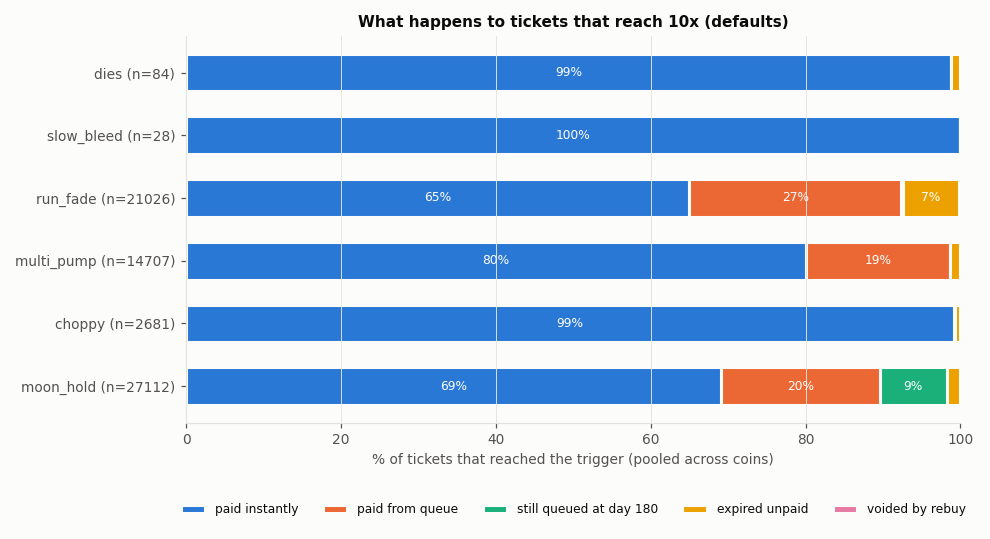
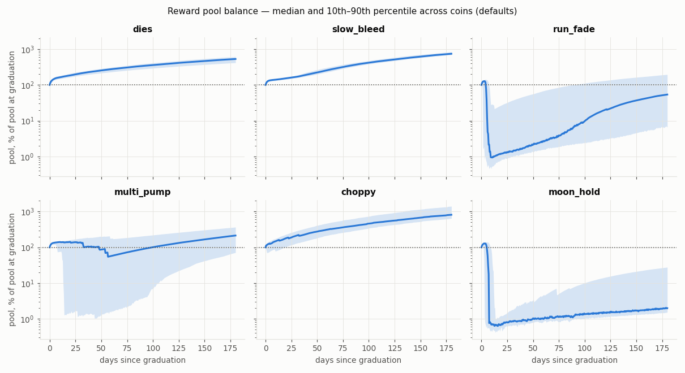
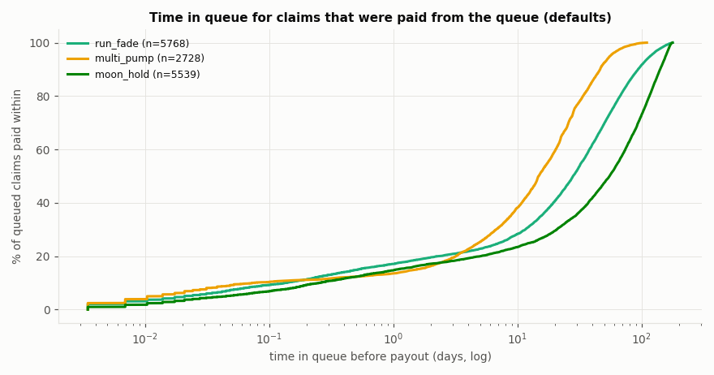
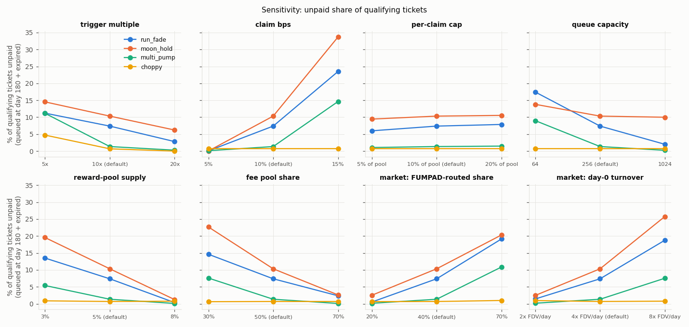

# FUMPAD reward pool — mechanism health simulation

Status: v1 · 2026-10-11 · 30 coins per scenario per variant (seeds 1–30), 180 days after graduation.
Reproduce: `sim/.venv/bin/python -m sim.run --full --seeds 30 --jobs 8` (≈ 45 min on 8 cores); the generated tables are in `out/tables.md`.
Two extra rows (`d1floor`, `abuse_d1floor`) came from `--scenario run_fade,moon_hold,multi_pump,choppy --seeds 30 --variant base,d1floor,abuse,abuse_d1floor`.

**Scope.** This measures whether the mechanism works: can pools pay the claims that qualify, how long claims wait, how full queues get, how often qualifying claims go unpaid, how far pools are drawn down, and how sensitive all of this is to the parameters. It makes **no revenue, profit, P&L or EV estimates** for anyone, and no claims about how often each scenario happens in the real world.

## Summary
1. **Coins that never run are not a solvency question.** In `dies`, `slow_bleed` and `choppy`, 0.1–1% of tickets ever reach 10x. 99%+ of those are paid instantly, queues stay empty, and the pool only grows. The pressure comes from coins that run 10x+ (`run_fade`, `multi_pump`, `moon_hold`). In those, ~10–11% of all tickets qualify, because everything sold before the run qualifies at once.
2. **With the defaults, runners drain the pool to ≈0.3–0.4% of its starting size (median) within days of the run.** The 10%-of-pool cap makes the drain geometric, so the pool never reaches zero, but it stops paying anything big. It refills only through fee buybacks and LP skims.
3. **Defaults leave 7.4% (run_fade) and 10.3% (moon_hold) of qualifying tickets unpaid** (90% bootstrap CI over coins: 4.8–9.7% and 7.9–12.5%). Unpaid means expired without ever getting into the queue, or still queued at day 180. That affects 23/30 and 25/30 coins. For multi_pump it's 1.3%.
4. **Queues fill and waits are long.** The queue hits its 256 capacity in 12/30 run_fade and 19/30 moon_hold coins. For claims paid from the queue, the median wait is 28 / 55 days and the p90 is 94 / 141 days (run_fade / moon_hold). In run_fade, 1,458 of 1,529 expired qualifying tickets expired because the queue was full when they tried to enter.
5. **The ratio of claim size to funding is the structural lever.** Every FUMPAD sell creates a liability of up to 10% of its tokens, but funds the pool with only 0.5% of its SOL (+~0.1% via the LP skim). So health gets worse as more volume routes through FUMPAD (run_fade unpaid: 0.5% at 20% routed → 7.4% at 40% → 19.1% at 70%) and as turnover rises (1.4% at 2× FDV/day → 18.8% at 8×). Claim bps is the strongest knob (5% → ~0.1% unpaid; 15% → 24–34%). Reward-pool supply and fee pool share come next.
6. **Per-claim cap, D16 and the trigger move little.** Changing the per-claim cap from 5% to 20% moves unpaid by ±1–2 points. D16 changes nothing for honest flow (≤0.2 points): it is a pure anti-spam bound. A 20x trigger cuts unpaid to 2.8–6.2% but halves how many tickets qualify.
7. **Abuse the spec allows has a visible footprint, but it doesn't break solvency.** 40 sybil wallets doing a $120 curve round trip at launch (D1) take a median 16–20% of payouts in runner coins, at the front of the line. Self-impact round-trippers (D12 cap) get a few large tickets, but their fees fund the pool, so honest unpaid share did not rise.
8. **Recommended:** `claim_bps` 7.5% (unpaid 0.1–0.2%, p90 wait 47–81 d), or keep 10% with reward pool 8% + fee pool share 70% + queue 1024 (unpaid 0.0–0.1%, p90 wait 33–75 d). See Recommendations.

## Model in one paragraph
Each coin is simulated alone. Phase A runs the bonding curve with exact integer math ported from `math/curve.rs` / `fees.rs` / `reference.rs`: agents buy and sell, inline buybacks happen, the D10 reference is tracked exactly, D12 ticket prices with the 10% cap are applied, along with the 10-min hold, the $50 minimum and the creator exclusion. Phase A then continues on the graduated PumpSwap pool along an exogenous seeded price path (six families). Agents (take-profit holders, scalpers, whales, three kinds of rebuyer, optional sybils and round-trippers) generate order flow consistent with the constant-product pool, and Phase A writes a tape. Phase B replays the reward mechanism on the tape:
- the pool and the 5-open-ticket limit;
- the rebuy rule;
- claims: 10% of tokens, paid now if ≤10% of the pool, otherwise queued;
- the skip-ahead `process_queue`, 256-entry capacity and D16;
- 90-day expiry for open tickets only;
- the buyback crank (±3% band, ≤0.5%-of-depth slices) and hourly LP skims.

Claim-side sweeps reuse the same tape (common random numbers). Ported math is unit-tested against the Rust (`sim/tests`, 24 tests): ≈85 SOL raised at completion, 14.7x start→graduation, graduation price continuity within 1 ppm, the 50/30/20 fee split, D12/reference/rebuy vectors.

## Scenarios
| scenario | shape |
|---|---|
| dies | pops to 1.1–2.5x within hours, then decays to 4–12% within days |
| slow_bleed | steady decline to 5–30% by day 30 |
| run_fade | runs to 10x–100x (peak at day 1–14), then fades to 10–30% of the peak |
| multi_pump | 2–4 pumps of 2–8x each within 60 days, 50–85% retrace after each |
| choppy | no trend, level 0.5–3x, large mean-reverting swings |
| moon_hold | runs to 20–60x over 3–20 days and holds (stress case) |

## Results with default parameters

| scenario | tickets | % reach 10x | paid instantly | paid from queue | still queued d180 | expired unpaid | claim tokens paid | queue wait median / p90 (d) | peak queue p90 / max | coins with a full queue | pool min (median % of start) |
|---|---|---|---|---|---|---|---|---|---|---|---|
| dies | 12,000 | 0.70% | 98.8% | 0.0% | 0.0% | 1.2% | 98.8% | – | 0/0 | 0/30 | 100% |
| slow_bleed | 19,564 | 0.14% | 100% | 0.0% | 0.0% | 0.0% | 100% | – | 0/0 | 0/30 | 100% |
| run_fade | 214,605 | 9.80% | 64.9% | 27.4% | 0.3% | 7.1% | 94.6% | 28.1 / 93.6 | 256/256 | 12/30 | 0.4% |
| multi_pump | 132,661 | 11.09% | 80.1% | 18.5% | 0.0% | 1.3% | 99.3% | 14.8 / 46.3 | 233/256 | 3/30 | 46.7% |
| choppy | 272,780 | 0.98% | 99.2% | 0.1% | 0.0% | 0.7% | 99.5% | 6.9 / 8.0 | 0/1 | 0/30 | 100% |
| moon_hold | 269,918 | 10.04% | 69.1% | 20.4% | 8.7% | 1.7% | 86.1% | 55.2 / 141.1 | 256/256 | 19/30 | 0.3% |

Cohort: tickets sold up to day 90 after graduation, curve sells included. Percentages are pooled over 30 coins. Voided-after-qualifying is ≤0.2% everywhere.

**Pool drawdown.** In runners the pool falls from ~100% to ~1% of its starting size within days of the run. It recovers slowly: by day 180 the median is ~50% in run_fade and ~2% in moon_hold, because a coin that stays high keeps creating qualifying tickets. In dies/slow_bleed/choppy the pool grows 4–8x in tokens. This is overstated, because buybacks have no lasting price impact in the model.

**Who drains it first.** Curve tickets (D1) are the oldest, so they claim first. They took a median 70–81% of the starting pool in runners. A non-spec variant that prices curve tickets at no less than the graduation price (`d1floor`) left unpaid within noise (run_fade 7.4 → 6.6%, moon_hold 10.3 → 9.3%). D1 changes who is paid first, not whether the pool copes.

**Where the unpaid claims come from.** In run_fade they are mostly tickets that qualified while the queue was full (1,458 of 1,529) or hit D16 (114). In moon_hold they are mostly claims too big for 10% of a drained pool (2,351 still queued at day 180, after a median wait of 173 days). Skip-ahead keeps paying the small claims behind them.

## Sensitivity
Cells show: % of qualifying tickets unpaid / p90 days in queue / p90 peak queue length.

| parameter | value | run_fade | moon_hold | multi_pump | choppy |
|---|---|---|---|---|---|
| defaults | | 7.4 / 94 / 256 | 10.3 / 141 / 256 | 1.3 / 46 / 233 | 0.7 / 8 / 0 |
| trigger | 5x | 11.2 / 99 / 256 | 14.5 / 146 / 256 | 11.2 / 56 / 256 | 4.7 / 10 / 18 |
| trigger | 20x | 2.8 / 96 / 256 | 6.2 / 138 / 256 | 0.3 / 27 / 39 | 0.0 / – / 0 |
| claim bps | 5% | 0.1 / – / 0 | 0.0 / – / 0 | 0.1 / – / 0 | 0.7 / – / 0 |
| claim bps | 15% | 23.5 / 132 / 256 | 33.7 / 155 / 256 | 14.6 / 105 / 256 | 0.7 / 32 / 1 |
| per-claim cap | 5% | 6.0 / 100 / 256 | 9.4 / 143 / 256 | 1.1 / 53 / 222 | 0.7 / 44 / 1 |
| per-claim cap | 20% | 7.9 / 90 / 256 | 10.5 / 139 / 256 | 1.5 / 44 / 239 | 0.7 / – / 0 |
| queue capacity | 64 | 17.4 / 80 / 64 | 13.8 / 144 / 64 | 9.0 / 25 / 64 | 0.7 / 8 / 0 |
| queue capacity | 1024 | 2.0 / 105 / 404 | 10.0 / 138 / 417 | 0.2 / 49 / 237 | 0.7 / 8 / 0 |
| D16 | unlimited | 7.3 / 94 / 256 | 10.3 / 141 / 256 | 1.3 / 47 / 235 | 0.7 / 8 / 0 |
| reward pool | 3% | 13.5 / 114 / 256 | 19.6 / 147 / 256 | 5.4 / 68 / 256 | 0.9 / 28 / 1 |
| reward pool | 8% | 0.4 / 58 / 236 | 1.2 / 117 / 238 | 0.1 / 28 / 9 | 0.8 / 37 / 0 |
| fee pool share | 30% | 14.6 / 125 / 256 | 22.7 / 150 / 256 | 7.6 / 84 / 256 | 0.6 / 46 / 1 |
| fee pool share | 70% | 2.4 / 70 / 256 | 2.6 / 128 / 256 | 0.1 / 18 / 72 | 0.7 / 0 / 0 |
| claim attentiveness | 5%/step | 8.6 / 94 / 256 | 11.0 / 142 / 256 | 4.3 / 47 / 241 | 17.5 / 4 / 0 |
| market: routed share | 20% | 0.5 / 76 / 153 | 2.5 / 132 / 168 | 0.1 / 33 / 70 | 0.6 / 19 / 1 |
| market: routed share | 70% | 19.1 / 100 / 256 | 20.3 / 151 / 256 | 10.9 / 49 / 256 | 1.0 / 1 / 0 |
| market: day-0 turnover | 2× FDV/day | 1.4 / 78 / 256 | 2.5 / 127 / 243 | 0.2 / 28 / 106 | 1.0 / 14 / 0 |
| market: day-0 turnover | 8× FDV/day | 18.8 / 114 / 256 | 25.8 / 154 / 256 | 7.5 / 78 / 256 | 0.8 / 0 / 0 |

Notes:
- **Queue capacity.** 1024 removes most expiry-while-full (run_fade 7.4 → 2.0%) but does nothing for moon_hold's drained pool. 64 is too small.
- **Per-claim cap.** It reshuffles who waits more than it changes how many get paid.
- **Attentiveness.** It matters in choppy coins, where qualification windows are short.
- **Market inputs.** The routed share and turnover move results as much as any mechanism parameter.

## Abuse patterns the spec bounds
Variant `abuse`: 40 sybil wallets, each buying $120 on the curve in its first 40 minutes and making two ≥$50 sells after the hold. Plus 3 round-trippers that repeatedly sell 25% of the pool's base reserve through FUMPAD and rebuy elsewhere in the same bundle.

The abuse market differs from the base market (extra agents change the random stream), so compare loosely.

| scenario | unpaid % abuse | unpaid % base | abusive tickets reaching 10x | payouts to abusive wallets (median) | sybils / round-trippers (seeds 1–8) |
|---|---|---|---|---|---|
| run_fade | 2.2 | 7.4 | 1,930 | 24.2% | 18.2% / 0.0% |
| moon_hold | 4.2 | 10.3 | 1,949 | 22.4% | 20.3% / 1.1% |
| multi_pump | 1.3 | 1.3 | 1,906 | 36.4% | 16.5% / 17.2% |
| choppy | 0.8 | 0.7 | 1,000 | 39.6% | – |

- **Sybil curve sellers** buy near the curve start, so their tickets qualify as soon as a coin holds about its graduation price. They are paid first. D16 limits each wallet, not the number of wallets. Their claims are small and fit at once, so they never block the queue; they take pool share instead. Flooring curve tickets at the graduation price did not measurably reduce honest unpaid share (run_fade 3.3%, moon_hold 5.8%). D1 stays an off-chain flagging question, not a solvency one.
- **Round-trippers** are bounded at a 10% discount by D12. Their 1% FUMPAD fee plus PumpSwap fees on large sells fund buybacks and LP skims.
- **Queue filling** by spam fails against a healthy pool, because small entries are paid at once.

## Recommendations (mechanism health only)
| option | run_fade unpaid / p90 wait / peak q p90 | moon_hold | multi_pump |
|---|---|---|---|
| defaults | 7.4% / 94 d / 256 | 10.3% / 141 d / 256 | 1.3% / 46 d / 233 |
| A. claim_bps 7.5% | 0.2% / 47 d / 216 | 0.1% / 81 d / 192 | 0.1% / 24 d / 0 |
| B. reward pool 8% + fee pool share 70% + queue 1024 | 0.1% / 33 d / 101 | 0.0% / 75 d / 27 | 0.1% / – / 0 |
| C. reward pool 8% + queue 1024 | 0.2% / 59 d / 236 | 1.2% / 119 d / 242 | 0.1% / 28 d / 9 |
| D. queue capacity 1024 only | 2.0% / 105 d / 404 | 10.0% / 138 d / 417 | 0.2% / 49 d / 237 |

1. **Change claim size or funding.** With the defaults, 7–10% of qualifying claims go unpaid in runners and queued claims wait a p90 of 3–5 months. Option A is the smallest change. Option B is the strongest if the 10% headline is fixed. B re-derives the curve (≈3% less LP supply) and moves the fee split to 70/18/12.
2. **Raise `CLAIM_QUEUE_CAPACITY` to 1024 regardless.** It's ~80 KB per graduated coin (≈8 `init_claim_queue` calls) and removes most expiries caused by a full queue. Alternative, not simulated: stop the 90-day clock at the first refused attempt.
3. **Keep** the per-claim cap at 10%, D16, and the trigger at 10x.
4. **Run an auto-claim keeper.** Choppy coins lose 17.5% of qualifying claims to slow claimers.
5. **Monitor the FUMPAD-routed share and queue load per coin** in production.

## Where the model is weakest
- **Exogenous prices.** Buybacks, payouts and round trips don't move the price, which overstates buyback token inflows in dead coins.
- **Uncalibrated behaviour.** Routed share, turnover, order sizes, take-profit targets and the rebuy mix are not fitted to data, and they matter as much as the mechanism parameters. Curve churn comes out at 5–9× the 85 SOL raised.
- **Non-strategic agents.** Nobody sells more because tickets exist or times claims around the queue.
- **Idealised infrastructure.** Median from 5-min samples, the keeper is always up, no Pyth outages, SOL fixed at $150.
- **Abuse comparison** is not common-random-number.
- **No scenario mix.** Nothing here says how often coins run, die or chop.
- **D16** was modelled from the spec (the simulation branched before contracts v0.3 implemented it); escrow for transfer-refusing accounts is not modelled.
- **30 coins per cell.** 90% bootstrap intervals are ±2–3 points at the defaults and ±0.1–0.5 points for options A and B.

## Assumptions
**Exact (ported):**
- the curve: 30 SOL / ~1,019.4M virtual, 753.4M on the curve, ≈85 SOL at completion, 14.7x, continuity into the LP;
- the 50/30/20 fee split with the inline curve buyback;
- D10 (exact TWAP on the curve) and D12 with the 10% cap;
- Position buckets and the 10-min hold;
- the $50 minimum on the ticket's tokens;
- creator exclusion and the 5-open-ticket limit;
- the 7-day rebuy rule;
- claim = 10% of ticket tokens, the 10%-of-pool cap, skip-ahead queue, no queue expiry, 90-day open-ticket expiry;
- the buyback band ±3% with 0.5%-of-depth slices, and the 0.20% LP fee with skims sending the base half to the pool;
- re-deriving the curve for other pool sizes the SPEC §3 way.

**Spec, not in code at simulation time:** D16, modelled as "the third queue entry is refused; the ticket stays Open" (now implemented that way in contracts v0.3).

**Modelled:**
- *Prices.* Exogenous paths with activity-scaled fat-tailed noise. With constant k, price moves force holders to absorb √(k/p) − √(k/p′) tokens. Turnover is 4× FDV/day on day 0, decaying with τ = 1.5 d to a 2%/day floor.
- *Oracle.* Lower median of the last six 5-minute prices; the PumpSwap reference is a 10-min EMA on max(previous, current).
- *Agents.* Buyers are 35% scalpers, 4% whales, the rest retail with take-profit targets 1.5–8×. 35% of retail/whale wallets rebuy: 50% via FUMPAD within 7 days, 30% elsewhere within 7 days, 20% after 7 days. 40% of wallets route through FUMPAD after graduation. Order sizes are lognormal, median 0.35 SOL, growing with √price.
- *Claimers.* Claim with p = 0.5 per 5-minute step while qualifying.
- *Keeper.* Cranks every 5 minutes; skims hourly.
- *Horizon.* 180 days; outcome cohort is tickets sold by day 90.
